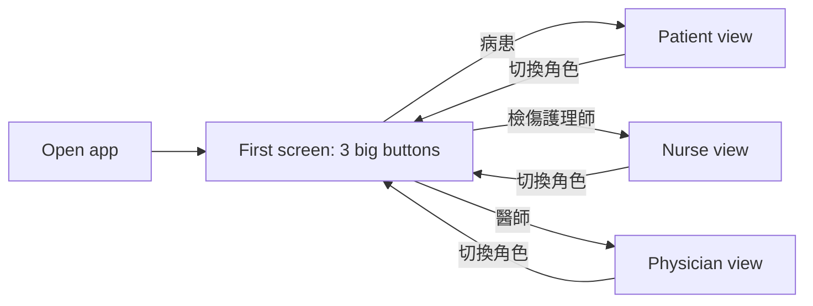
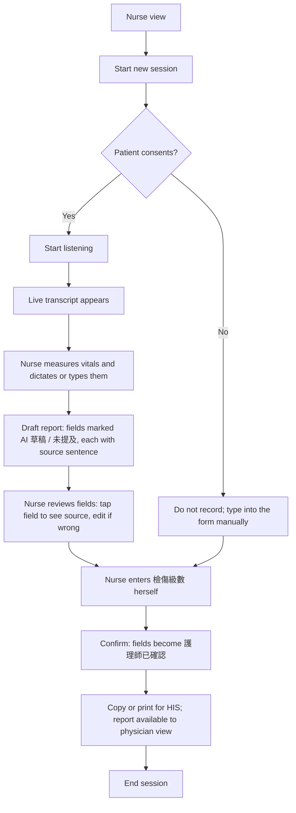
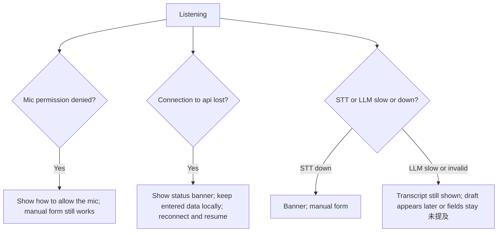
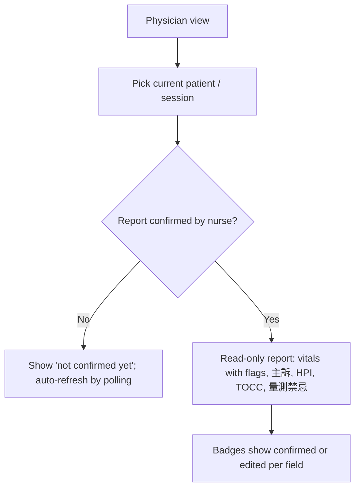
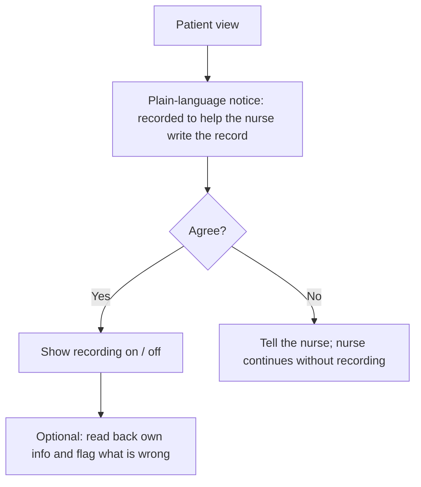

# Frontend: User Flows

Status: **draft.** Diagrams use Mermaid (rendered by GitHub). Personas and stories: [`PERSONAS_STORIES.md`](PERSONAS_STORIES.md).
Target device: tablet, landscape first (about 1024–1194 px wide), portrait must still work.

## 1. Entry: choose a role (demo)

The role is the route (`/patient`, `/nurse`, `/doctor`). No login. Switching role never deletes a session.

## 2. Nurse: triage session (main flow)

Rules visible in the flow:
- The AI path never reaches 檢傷級數; that node is entered by the nurse only.
- Nothing is saved as confirmed until the nurse confirms.
- The nurse can leave the AI path at any time and finish by typing.

## 3. Nurse: failure and fallback

Principle: a failure never blocks triage and never fills fields with guesses. Empty (`未提及`) beats invented.

## 4. Physician: read the report

## 5. Patient (待確認 scope)

## Screen-by-screen summary

| Screen | Primary user | Route | Key content |
|---|---|---|---|
| Role select | all | `/` | three big role buttons, demo notice |
| Patient | patient | `/patient` | notice, recording state, optional read-back |
| Nurse session | nurse | `/nurse` | recorder, transcript, draft form, vitals, level entry, confirm |
| Physician report | physician | `/doctor` | read-only confirmed report |
| Evaluation mode | evaluator | later | scenario picker, timer, event log (not on the first screen) |
