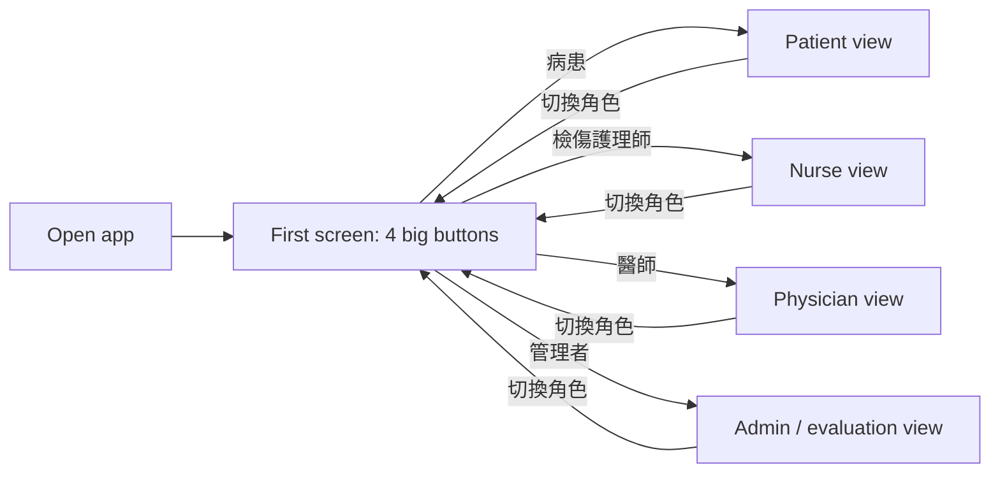
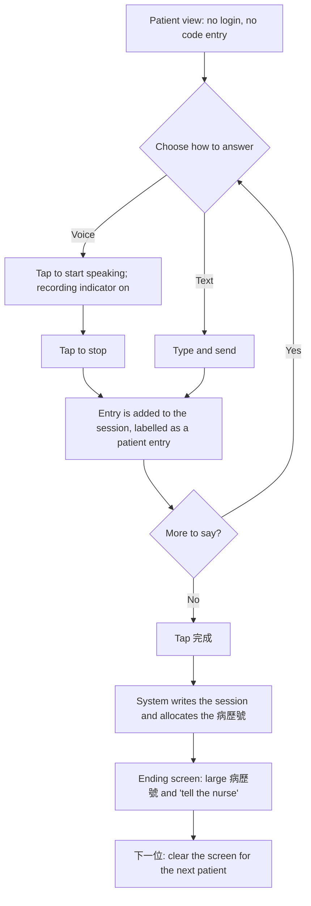
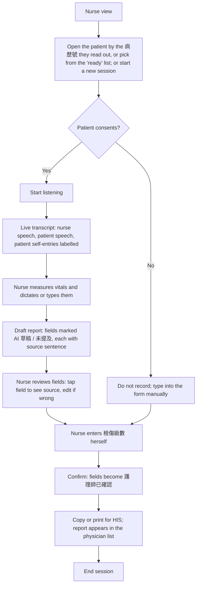
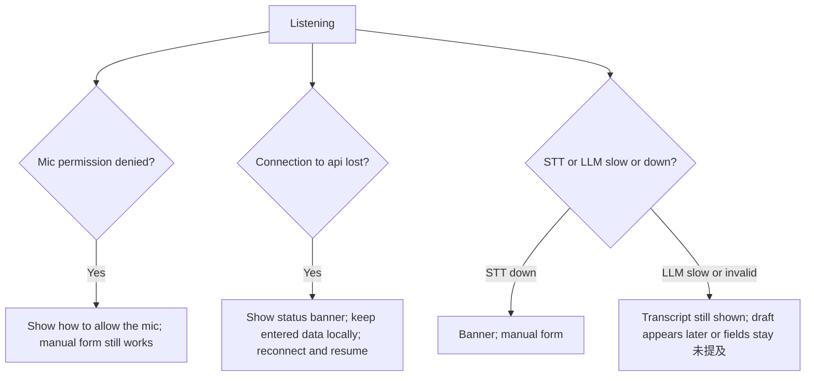
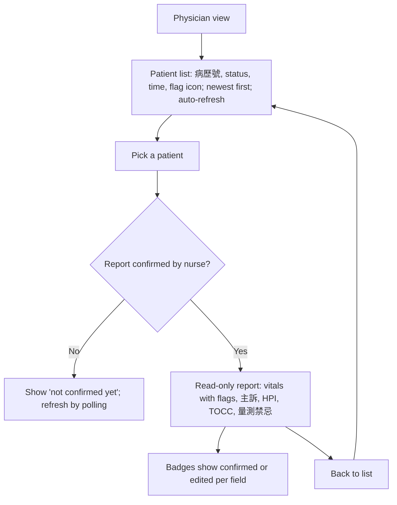
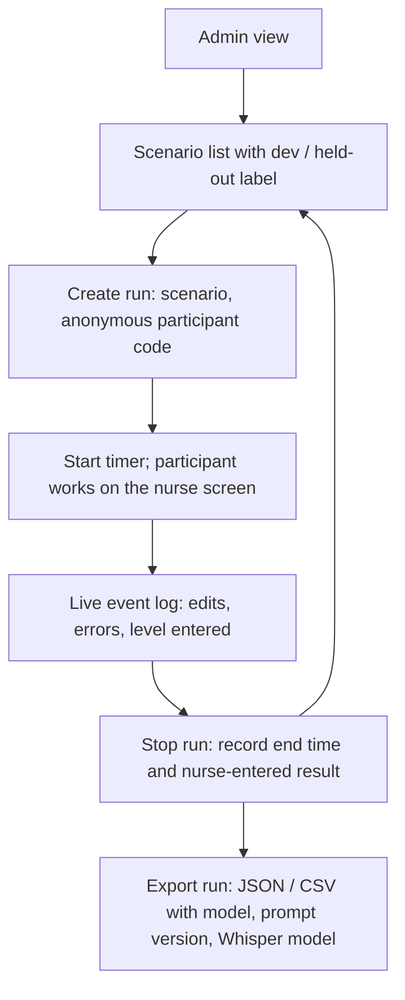

# Frontend: User Flows

Status: **draft.** Diagrams use Mermaid (rendered by GitHub). Personas and stories: [`PERSONAS_STORIES.md`](PERSONAS_STORIES.md).
API calls referenced here: [`API_INTERFACE.md`](API_INTERFACE.md).
Target device: tablet, landscape first (about 1024–1194 px wide), portrait must still work. Default text is large (18 px base, 20 px on tablet).

## 1. Entry: choose a role (demo)

The role is the route (`/patient`, `/nurse`, `/doctor`, `/admin`). No login. Switching role never deletes a session.

## 2. Patient: speak or type, then receive a 病歷號

Rules:
- No ID, name or personal detail is asked for. The 病歷號 is a simulated number the **system** gives at the end (`SIM-######`).
- 完成 is enabled only after at least one entry and when not recording.
- A recording indicator is always visible while recording.
- The patient never sees AI drafts, flags, a triage level or advice.
- Leaving before 完成 means no 病歷號 is issued and the unfinished entries are discarded after a timeout.

## 3. Nurse: triage session (main flow)

Rules visible in the flow:
- The AI path never reaches 檢傷級數; that node is entered by the nurse only.
- Nothing is saved as confirmed until the nurse confirms.
- The nurse can leave the AI path at any time and finish by typing.

## 4. Nurse: failure and fallback

Principle: a failure never blocks triage and never fills fields with guesses. Empty (`未提及`) beats invented.

## 5. Physician: pick from a list, then read

List statuses: `等候中` (patient finished intake, nurse not started), `進行中` (nurse working), `已確認` (confirmed). Only `已確認` reports open fully.

## 6. Admin: evaluation mode

Evaluation controls live only on this route, so the nurse working screen stays clean. The participant code is anonymous (no names).

## Screen-by-screen summary

| Screen | Primary user | Route | Key content |
|---|---|---|---|
| Role select | all | `/` | four big role buttons, demo notice |
| Patient | patient | `/patient` | voice input, text input, recording indicator, ending screen with 病歷號 |
| Nurse session | nurse | `/nurse` | recorder, transcript, draft form, vitals, level entry, confirm |
| Physician | physician | `/doctor` | patient list (by 病歷號), read-only confirmed report |
| Admin | evaluator | `/admin` | scenario picker, timer, event log, export |
